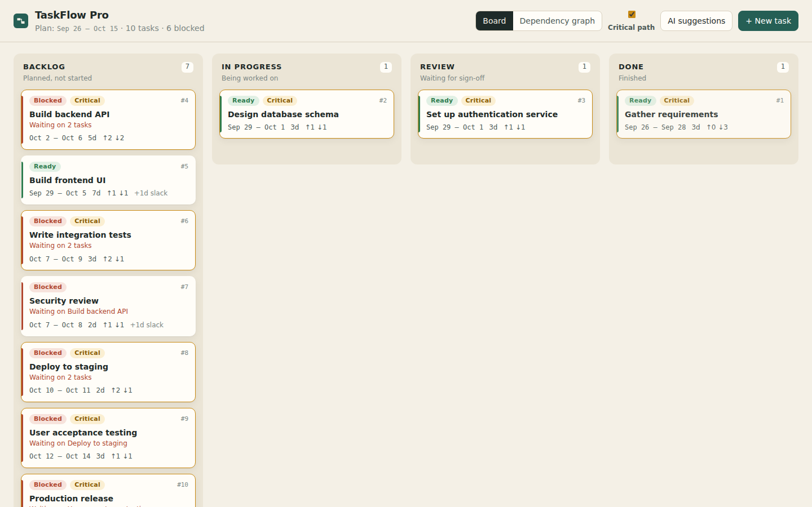

# TaskFlow Pro

A Kanban board that understands task dependencies. Behind the four columns
(Backlog, In Progress, Review, Done) sits a dependency engine that keeps the
plan valid: it refuses circular links, works out which tasks are Blocked or
Ready, and moves later tasks automatically when an earlier one slips, without
ever counting the same delay twice.

Built for the Contata NCR Hackathon 2026, problem statement PS-01.



## What it does

| Requirement | How it is handled |
|---|---|
| Drag-and-drop Kanban, persisted | dnd-kit on the frontend, fractional ranks in the database, optimistic UI that rolls back if the server refuses |
| Create and manage tasks | New-task dialog and a task drawer (title, description, dates, prerequisites, delete) |
| Prerequisite dependencies | Added from the task drawer; every link is dry-run checked before the Add button is enabled |
| Blocked / Ready status | Derived from the graph on every read, never stored, so it cannot go stale |
| Automatic schedule propagation | Topological pass over the affected tasks only; start = latest prerequisite end + 1 day |
| **No cycles** | Shortest-path search finds the loop a new link would close; the link is rejected with the loop spelled out and nothing is saved |
| **No compounding** | Propagation takes a *maximum*, not a sum, so A +3 reaching D via B and via C moves D by 3, not 6 |
| **Rollback on regression** | Moving a Done task back re-blocks its dependents immediately, with a message saying which ones |
| **Persistence** | SQLite locally, PostgreSQL in production; everything survives a refresh |
| Critical path (bonus) | Backward pass over scheduled dates gives each task's slack; zero-slack chain is highlighted on the board and in the graph view |
| AI dependency suggestions | LLM (OpenAI or Anthropic) or an offline keyword model proposes links; five validation gates; nothing is saved until a person accepts it |

## Quick start

### Option A: Docker (one container, SQLite)

```bash
docker build -t taskflow-pro .
docker run -p 8000:8000 taskflow-pro
# open http://localhost:8000
```

### Option B: run locally

Requirements: Python 3.11+, Node 20+.

```bash
# 1. API
cd backend
python -m venv .venv
source .venv/bin/activate            # Windows: .venv\Scripts\activate
pip install -r requirements-dev.txt
uvicorn app.main:app --reload --port 8000

# 2. Web app (second terminal)
cd frontend
npm install
npm run dev                          # http://localhost:5173, proxies /api to :8000
```

The demo board (10 tasks) is created automatically on first start. To put it
back to its original state:

```bash
cd backend && python -m app.seed --reset
```

### Optional: use a real LLM for suggestions

Copy `.env.example` to `.env` (or export the variables) and set **one** key:

```bash
OPENAI_API_KEY=...        # uses gpt-4o-mini by default
# or
ANTHROPIC_API_KEY=...     # uses claude-haiku-4-5 by default
AI_MODEL=...              # optional override
```

Without a key the app uses the built-in keyword model, so the feature always
works offline. Keys are read from the environment only and are never sent to
the browser or committed.

## Try the rules in two minutes

1. **Blocked / Ready**: drag *Build backend API* to In Progress. It is refused
   because the schema and auth service are not Done.
2. **No compounding**: open *Gather requirements* and push its end date out by
   3 days. The toast lists every task that moved: *Build backend API* moves
   exactly 3 days even though it is reached through two paths.
3. **No cycles**: in the same drawer, try adding *Production release* as a
   prerequisite. The loop is shown before you can press Add.
4. **Rollback on regression**: drag *Design database schema* and *Set up
   authentication service* to Done, start *Build backend API*, then drag the
   schema back to In Progress. The API card turns Blocked straight away.
5. **AI**: open *AI suggestions* → *Suggest dependencies*. It finds the missing
   *Security review → Production release* link, and shows how many proposals
   each validation gate dropped. Accept it and it appears on the board.
6. **Critical path**: switch to *Dependency graph*.

## Key assumptions and limitations

Assumptions:

* Dates are calendar days (no weekends or holidays) and inclusive: Oct 4 to
  Oct 6 is 3 days.
* Every link is finish-to-start with no gap: a task may start the day after its
  latest prerequisite ends.
* Schedules are **push-only**. When a task slips, later tasks move out just
  enough. When a task finishes early, nothing is pulled in automatically;
  people re-plan by editing dates.
* A task can always go to Backlog. It can only enter In Progress, Review or
  Done when every prerequisite is Done.
* On regression, dependents keep their column and get a Blocked badge rather
  than being moved without warning. A dependent that is already Done stays
  Done but is flagged, so nothing silently disappears from the Done column.
* Editing a task so it would start before a prerequisite finishes is rejected
  with the earliest valid start date, rather than silently corrected.

Limitations:

* One project, no user accounts or permissions (out of scope for the sprint).
* Every change returns the whole board. That is fine for hundreds to a few
  thousand tasks; beyond that the API should return only the changed tasks.
* Concurrency safety across several server processes needs PostgreSQL (a
  transaction-scoped advisory lock). With SQLite, run a single process.
* The AI rate limit is kept in memory per process.
* The keyword model only finds links that are written down in a description.
  LLM suggestions whose evidence is paraphrased rather than quoted are dropped
  by the evidence gate, so some correct suggestions can be lost.

More detail: [docs/DESIGN.md](docs/DESIGN.md) and the known failure cases in
[docs/TESTING.md](docs/TESTING.md).

## Tests

```bash
cd backend && pytest             # 61 tests: engine, property-based, API, AI, concurrency
cd frontend && npm test          # UI helper tests
```

The property-based tests generate hundreds of random projects and check that,
after any delay, every dependency still holds, nothing moves further than the
original delay, and running propagation twice changes nothing.
See [docs/TESTING.md](docs/TESTING.md) for the full list, how to run against
PostgreSQL, and the benchmark (`python -m scripts.benchmark`: under 1 ms to
propagate a delay through 1,000 tasks and 3,000 links).

## Project layout

```
backend/
  app/engine/graph.py     pure dependency engine (no DB, no web code)
  app/services/board.py   loads data, calls the engine, saves in one transaction
  app/services/ai.py      providers, prompt, validation gates, accept/reject
  app/api.py, main.py     FastAPI routes and error handling
  app/seed.py             10-task demo project
  tests/                  pytest + hypothesis
frontend/
  src/components/         board, card, drawer, AI panel, graph view
  src/lib.ts              pure helpers (grouping, optimistic move, layout)
docs/                     design document, testing notes, screenshots
```

## Deployment

The Dockerfile builds the React app and serves it from FastAPI, so a single
container hosts everything. On Render, Railway or Fly.io:

* build from the repository root with the Dockerfile,
* set `DATABASE_URL` to a PostgreSQL URL for persistent storage
  (`postgres://` URLs are accepted),
* optionally set `OPENAI_API_KEY` or `ANTHROPIC_API_KEY`,
* optionally set `ALLOW_DEMO_RESET=true` for a public demo.

## AI-Tool Declaration

**Tools used while building this project**

* **Claude (Anthropic)**, used through the Claude desktop app. It generated most
  of the initial source code, tests and documentation in this repository from
  the design in my synopsis, and ran the test suites and browser checks. I set
  the design and requirements, directed the work, and reviewed and tested the
  result.

**AI inside the product**

* Dependency suggestions use OpenAI (`gpt-4o-mini` by default) or Anthropic
  (`claude-haiku-4-5` by default) when an API key is configured, otherwise a
  local keyword model. Prompts are in `backend/app/services/ai.py`.
* Model output is treated as untrusted: it is schema-checked, grounded against
  the task text, dry-run through the engine, and only saved after a person
  accepts it.

## Open-source libraries

FastAPI, SQLAlchemy, Pydantic, httpx, psycopg, pytest, Hypothesis (Python);
React, TanStack Query, dnd-kit, React Flow (`@xyflow/react`), Vite, Vitest
(JavaScript). All are used under their MIT, BSD, Apache-2.0 or LGPL licences.
